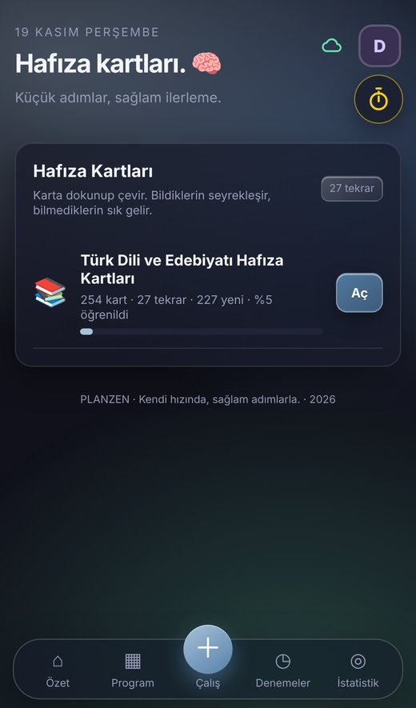
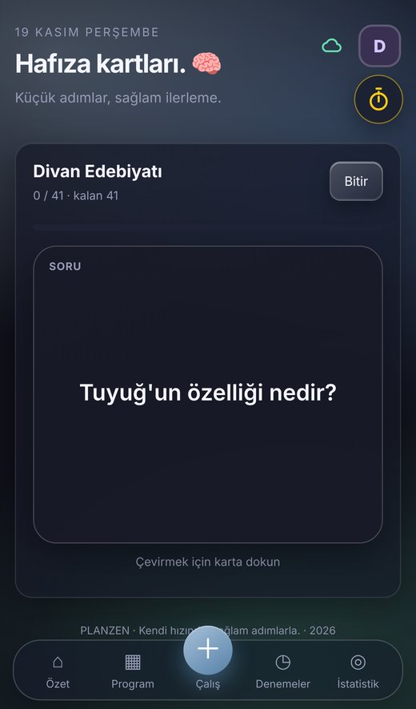

<div align="center">


<br>

**YKS'ye hazırlanan öğrenciler için sakin, sağlam çalışma planlayıcı.**


**[🌐 Canlı demo](https://KULLANICIADIN.github.io/PlanZen/)** · **[✨ Özellikler](#-özellikler)** · **[🛠 Kurulum](#-kurulum)** · **[🔒 Güvenlik](#-güvenlik-ve-gizlilik)**

</div>

---

## 📱 Ekran görüntüleri

<div align="center">


</div>

<br>

<div align="center">


</div>

<sub>Görüntülerdeki öğrenci ve veriler örnektir.</sub>

---

## ✨ Özellikler

| | |
|---|---|
| ⏱ **Odak sayacı** | Dersi seç, başlat; süreler ders ders birikir. Geçmiş günler düzeltilebilir. |
| 🗓 **Haftalık program** | Zaman aralıklı Ders / Konu / Soru blokları, sürükle-bırak, sadakat yüzdesi, arşiv ve gelecek hafta planı. |
| 📊 **Soru ve deneme takibi** | Doğru / yanlış girişi, net hesabı (doğru − yanlış/4), ders ve konu bazlı istatistik, zayıf konular, deneme net grafiği. |
| 🧠 **Hafıza kartları** | Türk Dili ve Edebiyatı, 254 kart, dönemlere ayrılmış. Aralıklı tekrar (Leitner) ile bildiklerin seyrekleşir. |
| 👥 **Arkadaşlar** | Kullanıcı adıyla ekle, haftalık süre ve istatistikleri karşılaştır. |
| 🏅 **Motivasyon** | Rozetler, seri, çalışma takvimi, paylaşılabilir haftalık özet görseli. |
| 🔔 **Bildirimler** | Sabah motivasyon mesajları ve duyurular (web push), yönetici paneli. |
| 💾 **Otomatik yedek** | Kullanıcı bir şey yapmadan her gece yedek alınır, son 14 gün saklanır. |
| 🛡 **Veri hakları (KVKK)** | Ayarlar'dan verilerini indir, hesabını kalıcı sil. |
| 🔑 **Hesap** | E-posta ile giriş, "şifremi unuttum", ayarlardan şifre değiştirme. |
| 🌗 **Görünüm** | Koyu / açık / dinamik tema, iPhone renk paleti, çevrimdışı açılış. |

## 🧩 Nasıl çalışır?

```
Telefon / tarayıcı                         Supabase
┌──────────────────────┐   giriş (Auth)   ┌──────────────────────┐
│ index.html (PWA)     │ ───────────────▶ │ Auth                 │
│ localStorage önbellek│   senkron        │ Postgres + RLS       │
│ sw.js (çevrimdışı)   │ ◀──────────────▶ │ Edge Functions (push)│
└──────────────────────┘                  │ pg_cron (yedek, push)│
                                          └──────────────────────┘
```

Veri önce cihazda tutulur, sonra bulutla birleştirilir; internet yokken de açılır, çakışmalar `mergeStates` ile çözülür.

## 📁 Dosyalar

| Dosya | Ne işe yarar |
|---|---|
| `index.html` | Uygulamanın tamamı (HTML, CSS, JS) |
| `sw.js` | Service worker: çevrimdışı açılış ve push bildirimleri |
| `manifest.webmanifest`, `icon-*.png` | Ana ekrana ekleme |
| `kartlar.json` | Hafıza kartlarının içeriği |
| `supabase_*.sql` | Veritabanı kurulum ve güncelleme dosyaları |

> `planzen-onizleme.html` yalnızca bilgisayarda deneme içindir (giriş ekranı kapalı, sahte veri). Depoya yüklenmemelidir.

## 🛠 Kurulum

1. [Supabase](https://supabase.com) üzerinde proje aç.
2. SQL Editor'da sırayla çalıştır: `supabase_kurulum.sql`, `supabase_guncelleme.sql`, `supabase_guncelleme_2.sql`, `supabase_duzeltme.sql`, `supabase_yedek.sql`, `supabase_hesap_silme.sql`.
3. `index.html` içindeki `SUPABASE_URL` ve `SUPABASE_KEY` (publishable key) değerlerini kendi projenle değiştir.
4. Supabase › Authentication › URL Configuration: **Site URL**'ye yayın adresini yaz, **Redirect URLs**'e `https://KULLANICIADIN.github.io/PlanZen/**` ekle (şifre sıfırlama ve e-posta doğrulama bağlantıları için gerekli).
5. Dosyaları GitHub'a yükle, Settings › Pages'den yayımla.
6. iPhone'da bildirim için siteyi Safari'den **Ana Ekrana Ekle** ile kur (iOS 16.4+).

> Bildirim sistemi için ek tablolar, iki Edge Function (`push-api`, `push-cron`) ve her dakika çalışan bir `pg_cron` işi gerekir; bunlar bu depodaki SQL dosyalarında yoktur.

## 🔒 Güvenlik ve gizlilik

- Tüm tablolarda satır güvenliği (RLS) açıktır; kullanıcı yalnızca kendi verisini ve arkadaşlarının paylaşılan özetini görür.
- Arkadaşlar ham verini değil, yalnızca profilindeki özet istatistikleri görür.
- Hesap silinince yedekler dahil her şey kalıcı olarak silinir.
- Supabase panelinden "Leaked password protection" özelliğini açman önerilir.

## 🧱 Teknoloji

Framework yok: saf HTML / CSS / JS tek sayfa. Arka uç Supabase (Auth, Postgres, Edge Functions, pg_cron), yayın GitHub Pages.

<div align="center">
<sub>Kendi hızında, sağlam adımlarla. · 2026</sub>
</div>
