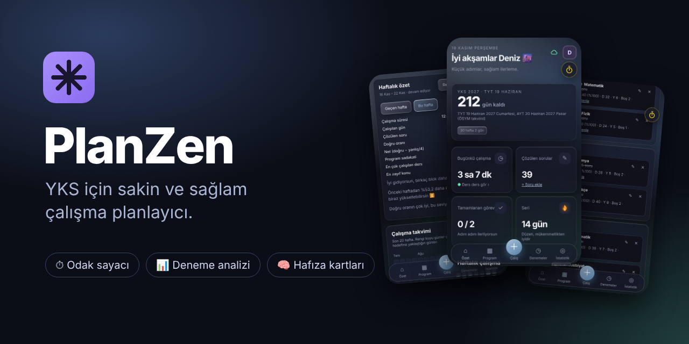
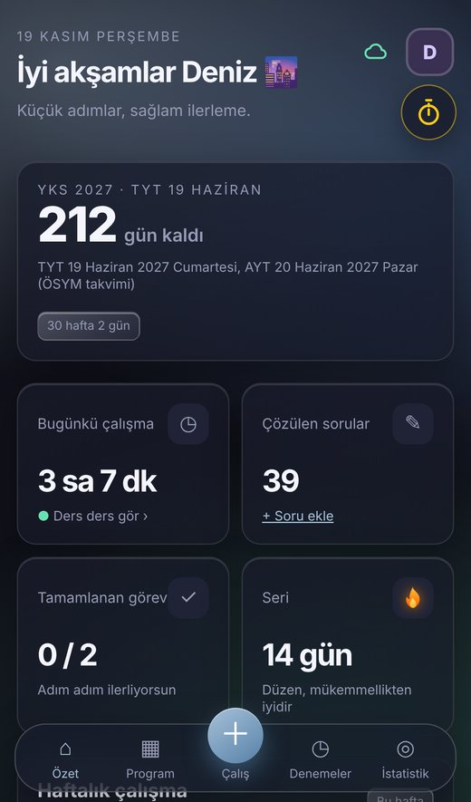
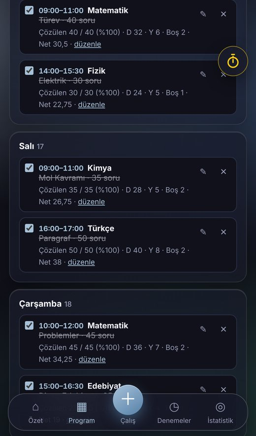
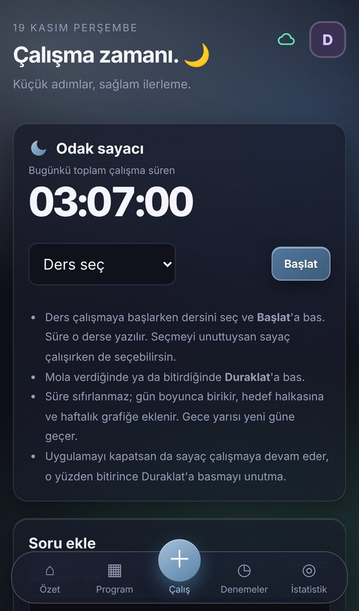
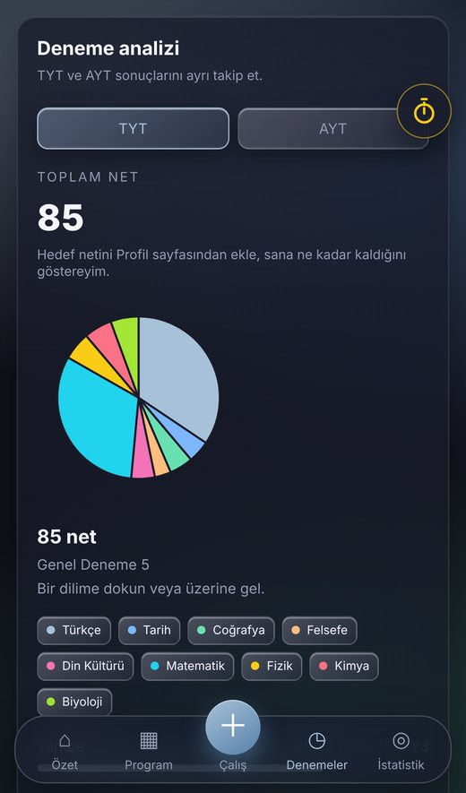
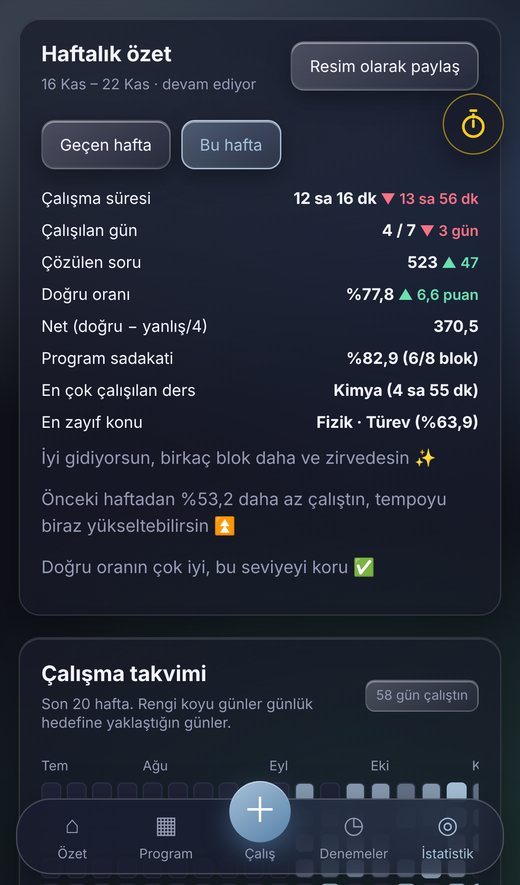

 

**YKS'ye hazırlanan öğrenciler için sakin, sağlam çalışma planlayıcı.**

**[🌐 Canlı demo](https://KULLANICIADIN.github.io/PlanZen/)** · **[✨ Özellikler](#-özellikler)**

---

## 📱 Ekran görüntüleri

 

Görüntülerdeki öğrenci ve veriler örnektir.

---

## ✨ Özellikler

| | |
|---|---|
| ⏱ **Odak sayacı** | Dersi seç, başlat; süreler ders ders birikir. Geçmiş günler düzeltilebilir. |
| 🗓 **Haftalık program** | Zaman aralıklı Ders / Konu / Soru blokları, sürükle-bırak, sadakat yüzdesi, arşiv ve gelecek hafta planı. |
| 📊 **Soru ve deneme takibi** | Doğru / yanlış girişi, net hesabı (doğru − yanlış/4), ders ve konu bazlı istatistik, zayıf konular, deneme net grafiği. |
| 🧠 **Hafıza kartları** | Öğrenmeyi kolaylaştıran ezber kartları. |
| 👥 **Arkadaşlar** | Kullanıcı adıyla ekle, haftalık süre ve istatistikleri karşılaştır. |
| 🏅 **Motivasyon** | Rozetler, seri, çalışma takvimi, paylaşılabilir haftalık özet görseli. |
| 🔔 **Bildirimler** | Sabah motivasyon mesajları ve duyurular (web push), yönetici paneli. |
| 💾 **Otomatik yedek** | Kullanıcı bir şey yapmadan her gece yedek alınır, son 14 gün saklanır. |
| 🛡 **Veri hakları (KVKK)** | Ayarlar'dan verilerini indir, hesabını kalıcı sil. |
| 🔑 **Hesap** | E-posta ile giriş, "şifremi unuttum", ayarlardan şifre değiştirme. |
| 🌗 **Görünüm** | Koyu / açık / dinamik tema, harika renk paleti, çevrimdışı açılış. |

## 📁 Dosyalar

| Meraklısına Dosya İçerikleri | Ne işe yarar |
|---|---|
| `index.html` | Uygulamanın tamamı (HTML, CSS, JS) |
| `sw.js` | Service worker: çevrimdışı açılış ve push bildirimleri |
| `manifest.webmanifest`, `icon-*.png` | Ana ekrana ekleme |
| `kartlar.json` | Hafıza kartlarının içeriği |
| `supabase_*.sql` | Veritabanı kurulum ve güncelleme dosyaları |

> `planzen-onizleme.html` yalnızca bilgisayarda deneme içindir (giriş ekranı kapalı, sahte veri). Depoya yüklenmemelidir. (Repoda yer almaz.)

Kendi hızında, sağlam adımlarla. · 2026

